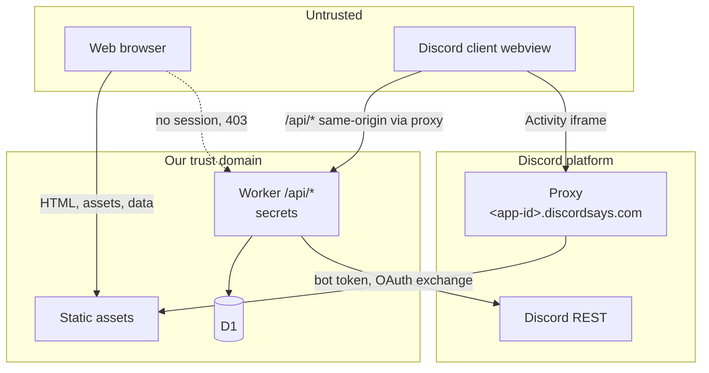

# Security architecture and threat model

Status: proposed, 2026-11-26. Applies the moment a dynamic component ships
(Workers with `main`, Discord Activity, D1). Until then `SECURITY.md` scope is
the whole model.

Related: #688 (Cloudflare free-tier assessment), #697 (Discord integration
epic). This document is the threat model of record; #688's resource decisions
are inputs to it, not a substitute.

---

## 1. Principles

1. **Static first.** Every dynamic route lives under `/api/*`. Only that prefix
   is in `assets.run_worker_first`. HTML, `/assets/*`, and `/data/*` never
   invoke the Worker — they stay free, cacheable, and outside the request
   budget. A Worker bug cannot take down page loads.
2. **Client input is data, never authority.** Identity, guild, channel, and
   score come from Discord-signed material or server-side records. The request
   body may name a game, never a user.
3. **Least privilege.** OAuth scope `identify` only. Bot permissions: Send
   Messages, Embed Links, Attach Files. No Administrator, no Manage Messages,
   no privileged intents (`MESSAGE_CONTENT` stays off). The bot can only touch
   messages it created.
4. **Secrets never leave the Worker.** Bot token, client secret, and public key
   are Worker secrets. Nothing in `dist/`, query strings, logs, or the client
   bundle.
5. **Deny by default.** Unknown interaction types, unknown guilds, unknown
   enums, unknown fields, oversize bodies → 4xx. Auth fails closed; audio fails
   open (existing `core/audio.js` behaviour) so a proxy/CDN problem never blocks
   play.
6. **Quota is an availability boundary.** 100k Worker requests/day and 10 ms
   CPU/invocation are hard limits, account-wide. Exhausting them is a DoS
   against every dynamic feature, so they get rate limits, alerts, and a kill
   switch.
7. **Results are social, not authoritative.** There is no anti-cheat because
   there cannot be one: `public/data/daily.json` ships plaintext `id` and the
   DJB2 hash is brute-forceable over ~2.4k species. Never surface "verified"
   scores, rewards, or access gated on server-recorded results.

## 2. Assets, in priority order

| Asset | Why it matters | Where it lives |
|---|---|---|
| Discord bot token | Post/edit/delete as the app, read channels it can see | Worker secret |
| OAuth client secret | Mint access tokens for any user who authorizes | Worker secret |
| Application public key | Verifies interactions; compromise → forged commands | Worker secret |
| Player session | Impersonate one player's board/guild | Cookie/token, short TTL |
| Discord identity (id, username, avatar) | Correlate and profile users | D1, if Phase 3+ ships |
| Per-guild results/streaks | Social data; deletion obligations | D1 |
| CSP / framing posture | Clickjacking, phishing, token theft | `public/_headers` |
| Cloudflare account | DNS, WAF, Workers, secrets | Dashboard / CI |
| Request quota (100k/day) | Availability for everyone | Cloudflare account |
| CI secrets (eBird key) + commit rights | Data pipeline integrity | GitHub |

## 3. Trust boundaries

- The Activity iframe's origin is the **proxy**, not the site. `/api/*` calls
  from inside the Activity are same-origin through the proxy. Cookies and
  `Origin` headers therefore need to be verified against the proxy host, not
  `audio-birdle.sechostlab.com` (see open questions).
- Anything rendered in the webview is attacker-controllable in a modified
  client; treat every `fetch` to `/api/*` as hostile.
- The proxy is a network intermediary we do not control. Treat its forwarding
  behaviour as untrusted and test it.

## 4. Actors

| Actor | Capability | Motivation |
|---|---|---|
| Anonymous web player | Full client, no session | Curiosity, scraping |
| Honest Discord player | Activity session, own board | Play |
| Malicious guild member | Same session, sees public boards | Spoof others, spam, spoil the daily bird |
| Modified client / self-hosted copy | Arbitrary HTTP to `/api/*`, arbitrary postMessage | Forge identity/results, probe |
| Token thief (XSS, shared device) | Victim's session until expiry | Impersonate |
| Quota burner | Cheap requests to `/api/*` | Deny service to all |
| Supply-chain attacker | npm/SDK/Action | Backdoor, exfiltration |
| Insider | Repo write, Cloudflare account | Everything |

## 5. Threats and controls

| ID | Threat | Control | Residual |
|---|---|---|---|
| S1 | **Forged identity** — body claims another `discord_id`/username | Worker derives identity from the OAuth token (`GET /users/@me`), never from the body. Session is signed/opaque, HttpOnly, `Secure`, `SameSite=Lax`, ≤60 min, bound to user + guild + channel (+ date) | Discord account takeover is out of scope |
| S2 | **Cross-guild posting** — client supplies a channel the bot can reach | Guild/channel come from the launch record (interaction or Activity instance), verified against bot membership. Never post to a client-supplied channel without a server check | If Discord exposes no instance→channel binding, store it at launch in D1 |
| S3 | **CSRF from the web origin** — attacker page posts with victim cookies | Activity endpoints accept only `Origin: https://<app-id>.discordsays.com`; JSON content type (non-simple); no wildcard CORS; `SameSite=Lax`; per-session CSRF token for state changes | None known |
| S4 | **Clickjacking/phishing** — page framed elsewhere now that XFO is gone | `frame-ancestors https://discord.com https://*.discordsays.com` only (verify exact origins); no `*`; `default-src 'self'`; `object-src 'none'`; `base-uri 'self'`; `form-action 'self'`; keep `upgrade-insecure-requests` | Any Discord-origin iframe may frame the site — accepted |
| S5 | **XSS → session theft** | CSP `script-src 'self'` (no inline, no eval), `textContent` only, no `innerHTML`; session in HttpOnly cookie, not `localStorage`; never in URLs or logs. Optional: `require-trusted-types-for 'script'` | Browser 0-days |
| S6 | **Interaction forgery/replay** | Ed25519 verify (`X-Signature-Ed25519`, `X-Signature-Timestamp`) over `timestamp + raw body` *before* JSON parse; reject wrong `application_id`/unknown `type` with 401; PING→PONG only; timestamp skew check | Replay of a captured valid interaction within skew — idempotency limits the impact |
| S7 | **Mention/format abuse** — username injected into message content pings `@everyone` or a role | Every bot message sets `allowed_mentions: { parse: [] }`; never echo user-supplied text beyond the display name; cap content length | None known |
| S8 | **Spam / board flooding** | Per-user and per-channel rate limits; edits only to bot-owned messages; debounce board updates; no DM sending; guild-level opt-in for summaries | Free-plan rate-limiting availability is uncertain — see open questions |
| S9 | **Quota exhaustion → site-wide dynamic outage** | `run_worker_first` limited to `/api/*`; alerts at 50/80/100% of 100k/day and on 1027/429; per-IP guard; Turnstile (free) on any unauthenticated dynamic endpoint; kill switch that disables `/api/*` features without touching static pages | A determined attacker can still burn the daily cap; static site continues |
| S10 | **Secret leakage** | Worker secrets only; separate dev/prod tokens; `wrangler secret put`; redact `Authorization`/`Cookie` in logs; gitleaks stays in pre-commit; rotate on suspicion | Insider with Cloudflare access |
| S11 | **Supply chain** — vendored Activity SDK / Actions | Pin SDK version + commit + SHA-256 with provenance JSON (Forever pattern); review the bundle diff; no runtime CDN (CSP forbids it); pin new Actions by commit SHA; Renovate does not automerge the SDK or Actions | Upstream compromise before pin |
| S12 | **Data over-collection / retention** | Store only Discord id, username, avatar, per-day results and streak counters. No message content, no email, no IP logs. Retention stated and enforced (results ≤90 days, streaks while installed); `/audiobirdle forget` deletes identity + rows; privacy page linked in the Discord app settings. Analytics is opt-in and default-off (CWA beacon never in HTML), aggregate only; Discord DAU uses a 48 h rotating-salt hash and is labelled pseudonymous. Inventory: `docs/privacy.md` | Legal review still required |
| S13 | **Injection** — D1/SQL, enums, payloads | Prepared statements only; region/mode/date validated against allowlists; body size cap (8 KB) before parse; reject unknown fields | None known |
| S14 | **Open redirect / malicious links** | `openExternalLink` only for `https:` + host allowlist (eBird, Macaulay, Cornell, xeno-canto); reuse `isHttpsUrl`; no user-supplied URLs | None known |
| S15 | **Cache mixing** | `/api/*` returns `Cache-Control: no-store`; `_headers` `/data/*` and `/assets/*` rules never match `/api/*`; no per-user data through the CDN cache; OAuth responses uncacheable | Cloudflare cache-rule misconfiguration — test it |
| S16 | **Shared-device data mixing** | Activity storage keys namespaced by Discord user id (the Discord webview is per install, not per account); no cross-user reads | Physical device access |
| S17 | **Platform/policy violation** | No unsolicited DMs; no message-content intent; Discord Developer Policy disclosures (privacy URL, data deletion); respect rate limits and app verification thresholds | Discord policy changes |

## 6. Ground rules (enforceable)

| # | Rule | Enforced by |
|---|---|---|
| G1 | Dynamic surface confined to `/api/*`; HTML/assets/data never routed through the Worker | `wrangler.jsonc` review + build test asserting `run_worker_first` |
| G2 | No secrets in repo/client; Worker secrets only | gitleaks, review, `dist` grep test |
| G3 | Identity server-derived; client JSON is data only | Auth matrix tests |
| G4 | OAuth `identify` only; bot perms Send Messages + Embed Links + Attach Files; no privileged intents | App config review (manual, documented) |
| G5 | Session: HttpOnly, Secure, SameSite=Lax, ≤60 min, bound to user+guild+channel | Session tests |
| G6 | Mutating endpoints: POST + JSON + Origin allowlist + session + CSRF token + rate limit + size cap | Route tests |
| G7 | `allowed_mentions: { parse: [] }` on every bot message | Payload unit test |
| G8 | `frame-ancestors` Discord-only; no wildcard CORS; no `unsafe-*` | `tests/test_sitegen_build.py`, `tests/e2e/test_live_site.py` |
| G9 | Minimise, retain, delete: `/privacy` + `docs/privacy.md`, analytics default-off, `/audiobirdle forget` before public launch | Release checklist |
| G10 | D1 prepared statements only; enum allowlists | Code review + tests |
| G11 | Third-party runtime code vendored, pinned, hashed, reviewed | provenance JSON + review |
| G12 | Fail closed on auth, fail open on audio | Route tests + audio fallback test |
| G13 | Quota alerts + kill switch before enabling the Activity for anyone | Ops checklist |
| G14 | No secrets/PII in logs; 3-day retention acknowledged | Review + log fixtures |
| G15 | Two-person review for `public/_headers`, `wrangler.jsonc`, `worker/`, `.github/workflows/` | Branch protection |

## 7. Verification map

| Control | Test |
|---|---|
| Framing allowlist, no XFO | extend `tests/test_sitegen_build.py`, `tests/e2e/test_live_site.py` |
| Interaction signature, types, PING | new Worker tests with fixed keypair fixtures |
| Session forgery/expiry/binding | Worker auth matrix (no cookie, wrong origin, expired, wrong guild) |
| CSRF | `Origin`/content-type rejection cases |
| `allowed_mentions` | assert every message payload builder output |
| Payload size/enums | oversize and invalid-region/mode/date cases |
| Rate limits | burst test per user and IP |
| `run_worker_first` scope | build assertion on `wrangler.jsonc` + request counter check |
| Cache | header assertion that `/api/*` is `no-store`; live `curl -D -` |
| Secret scan | gitleaks in pre-commit and CI |

## 8. Accepted risks

- **Answer leakage.** The daily bird is in the client by design; server-side results are cosmetic. Documented in `SECURITY.md`.
- **Public results.** Anyone in the channel sees boards; that is the feature.
- **Discord account compromise** and **Cloudflare/Discord platform compromise** are out of scope.
- **Guild admins** can read and delete bot messages; nothing to defend.
- **Free-tier rate limiting gaps.** Worker-side limits are approximate; a determined attacker can exhaust the daily quota. Static pages survive; dynamic features degrade until reset.
- **Opt-in analytics bias.** Consented visitors are a non-random sample, so DAU and trend figures are directional, not exact. Accepted because the alternative is tracking people who declined.

## 9. Open questions (must be resolved in Phase 0/1)

1. Does the Activity proxy forward `Set-Cookie` and expose the true `Origin`? If not, sessions move to an in-memory token + `Authorization` header, which changes the XSS calculus (S5).
2. Is the instance → guild/channel binding available server-side (`activity-instances`), or must it be recorded at launch?
3. Which Cloudflare rate-limiting / Bot Fight Mode features exist on the Free plan today? If not enough, Turnstile plus D1-backed counters.
4. Exact `frame-ancestors` origins required by the current Activity proxy.
5. Retention window and deletion flow wording for the privacy page.
6. Cloudflare Web Analytics: current retention, exact beacon hosts, and whether beacon mode (not automatic setup) is required for an opt-in flow on Workers static assets.
